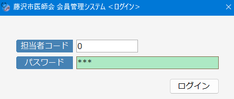
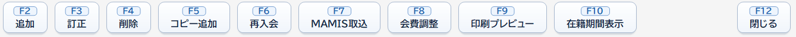

# 作業内容: 2026/11/25

## Branch: dev
こちらは依頼のあったものだけ入っています。

### FormMain2
FormMain に変わるフォームです（コントロール・フォーム仕様.md）
- 予想できる部分はボタンから機能を呼び出せるようにしてあります
- Resources のアイコンのほとんどがこれで不要に

## Branch: funckey
諸々の問題、簡単に解決できそうなコントロールについて改善を行った版です

### カスタムスケーリングの問題
FormFrame の OnLoad で scaleForDeviceDpi() を呼び出します。
これで問題解決……と思いますが、各画面確認をお願いします。



### FunctionKeyBar


GcFunctionKey はお世辞にもいいコントロールではないので、自前 funckey を作成しました。（ファンクションキー.md）

- **Entry Save Exec** は色が青になっていますが、AppFuncKey.xlsx でフラグ指定したものを青くしてもいいかも
- 自動的に左寄せ、右寄せを行います
- `AppFunctionKey` の代わりに `FunctionKeyBinder` を使います
- **GcFunctionKey を使っている全てのフォームを置き換えました**
- `GcFunctionKey`, `AppFunctionKey` は完全に不要になります。`AppFormFunctionKey` はそのまま使用してください

#### 注意：AppFunctionKey.Exec.Execute = … はメモリリークの原因
以前の static に定義するコードのせいで、**フォームを消しても AppFunctionKey にフォームが残るようになっていました。**
この問題の対応策として、FunctionKeyBinder では On メソッドに変更されています。

```csharp
funcKeys = new FunctionKeyBinder(funckey, FuncMasterBasic.Functions);

funcKeys.On(FuncMasterBasic.ShowBank, showBank);
funcKeys.On(FuncMasterBasic.Save, saveClose);
funcKeys.On(FuncMasterBasic.Cancel, cancelClose);
```

### UcTableComboBox
- 左にｉがあって、あらゆる画面で気味の悪いジグザグ配置になっていたので、右に移動
- ｉを画像ではなく、IconBox 化した。`Resources/information` は不要
